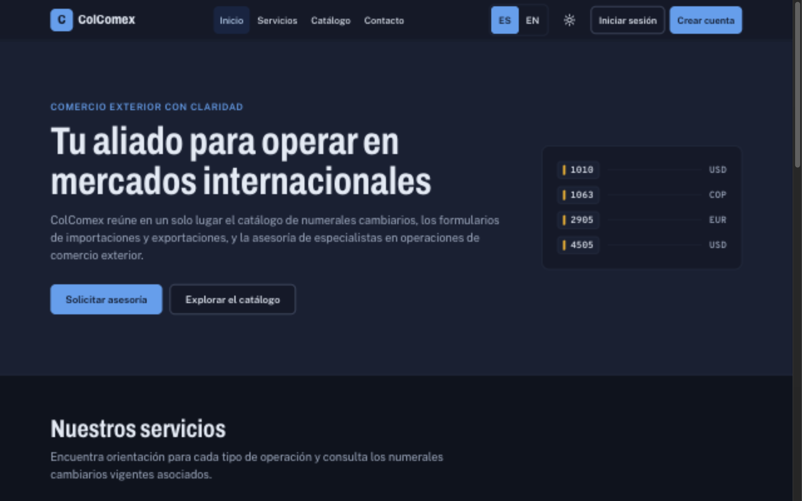
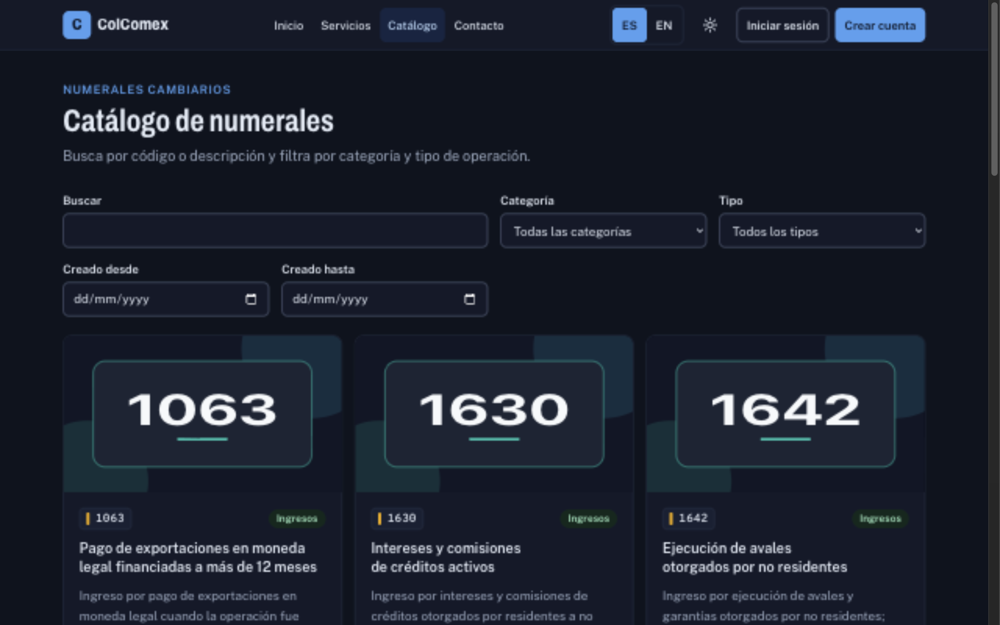
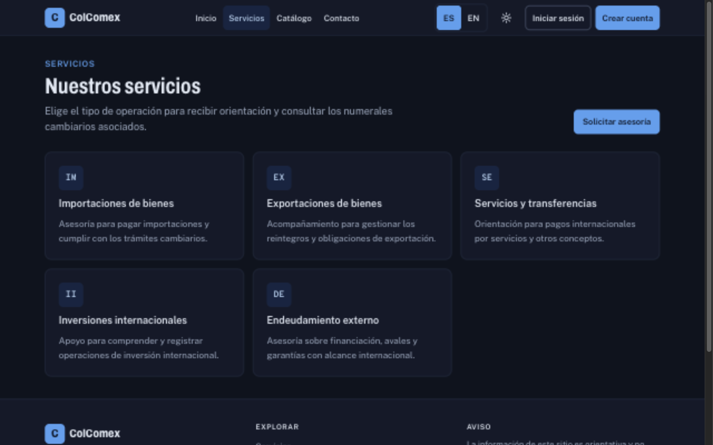
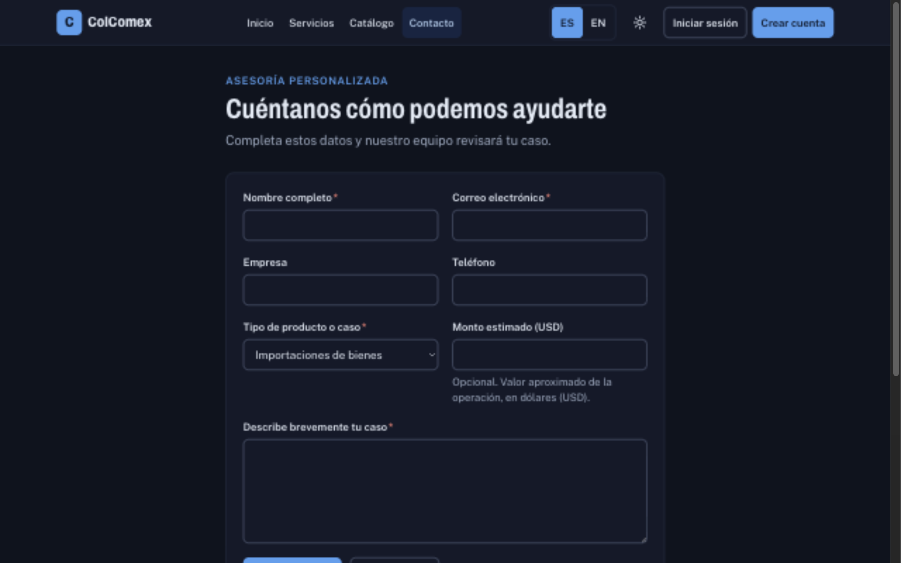

# ColComex Web

Frontend de ColComex, una plataforma de asesoría en comercio exterior (importaciones, exportaciones, inversiones, endeudamiento externo y servicios). Los visitantes consultan el catálogo público de numerales cambiarios y envían solicitudes de asesoría. Los usuarios registrados diligencian formularios de operación y de declaración de cambio, y los administradores gestionan el catálogo, revisan la actividad y dan de alta a otros administradores.

Construido con Next.js 16 (App Router), React 19, TypeScript estricto y Tailwind CSS 4. Consume la API REST del backend (`proyecto-comex-backend`), cuyo contrato está en [docs/openapi.yaml](https://github.com/cindy1204/proyecto-comex-backend/blob/main/docs/openapi.yaml) y en Swagger UI.

## Enlaces

| Recurso                              | Enlace                                                |
| ------------------------------------ | ----------------------------------------------------- |
| Frontend desplegado (Vercel)         | https://proyecto-comex-frontend-7sju.vercel.app       |
| API desplegada (Render)              | https://proyecto-comex-backend.onrender.com           |
| Documentación de la API (Swagger UI) | https://proyecto-comex-backend.onrender.com/api/docs/ |
| Repositorio del frontend             | https://github.com/cindy1204/proyecto-comex-frontend  |
| Repositorio del backend              | https://github.com/cindy1204/proyecto-comex-backend   |

Integrantes del equipo: **Miguel Cárdenas** y **Cindy Bohorquez**.

## Reparto del trabajo

| Componente | Responsabilidades                                                                                                                                                    |
| ---------- | -------------------------------------------------------------------------------------------------------------------------------------------------------------------- |
| Frontend   | Interfaz Next.js, navegación, sesión en el cliente, formularios, catálogo, solicitudes, experiencia adaptable, idiomas (es/en) y descarga en PDF de los formularios. |
| Backend    | API REST, autenticación y roles, validación, persistencia con Prisma y PostgreSQL, migraciones, seed de prueba y documentación OpenAPI.                              |

## Capturas

Capturas tomadas del despliegue de producción.

| Inicio                         | Catálogo                                        |
| ------------------------------ | ----------------------------------------------- |
|  |  |

| Servicios                            | Contacto                           |
| ------------------------------------ | ---------------------------------- |
|  |  |

## Funcionalidades

- **Catálogo público** (`/catalogo`): listado paginado con filtros combinables (categoría, ingreso o egreso, búsqueda y rango de fechas). Si un numeral no tiene imagen, se muestra una ilustración con su código.
- **Administración del catálogo** (`/admin`): alta, edición, eliminación lógica y restauración de numerales, con subida de imagen (JPG, PNG o WebP de hasta 5 MB) y vista previa.
- **Formularios de operación** (importaciones y exportaciones): se diligencian, se guardan y se descargan en PDF. Los montos aceptan coma o punto decimal, y el valor en dólares y el reintegro neto se calculan en centavos.
- **Declaraciones de cambio** (servicios, inversiones y endeudamiento): campos de datos mínimos y una hoja PDF marcada como no oficial.
- **Mis operaciones** (`/mis-interacciones`, `/mis-solicitudes`): el usuario lista, filtra, consulta, edita y elimina sus propios registros. El administrador ve el listado global.
- **Solicitudes de contacto** (`/contacto`): formulario público. Con sesión iniciada, la solicitud queda asociada a la cuenta.
- **Servicios** (`/servicios`): contenido informativo, numerales relacionados y enlace al formulario de cada servicio.
- **Experiencia común:** tablas que pasan a tarjetas en móvil, modo claro y oscuro, idioma español o inglés, y mensajes de estado anunciados a lectores de pantalla.

## Instalación y ejecución local

Requisitos: Node.js 22 o superior y el backend en ejecución (por defecto en `http://localhost:3001`).

```bash
npm install
cp .env.example .env.local   # ajusta NEXT_PUBLIC_API_HOST si el backend no está en localhost:3001
npm run dev                  # http://localhost:3000
```

Para producción: `npm run build && npm run start`.

### Variables de entorno

| Variable               | Obligatoria       | Descripción                                                                                                |
| ---------------------- | ----------------- | ---------------------------------------------------------------------------------------------------------- |
| `NEXT_PUBLIC_API_HOST` | Sí, en producción | Origen del backend **sin** `/api` ni barra final. En desarrollo, si falta, se usa `http://localhost:3001`. |

`NEXT_PUBLIC_API_HOST` se incrusta al compilar: define el valor antes de `npm run build`. No se sube ningún `.env` real al repositorio; solo `.env.example`.

## Despliegue

- **Vercel:** Add New → Project, importa `cindy1204/proyecto-comex-frontend` y define `NEXT_PUBLIC_API_HOST` con la URL pública del backend en Settings → Environment Variables. Después de cambiar la variable, vuelve a desplegar.
- **Conexión con el backend:** el dominio exacto de Vercel debe estar en `CORS_ORIGINS` del backend. Si no, las peticiones del navegador responden 403.

## Cuentas de prueba

Usuarios creados por el seed del backend. Las contraseñas se comparten en privado y no están en este repositorio.

| Rol           | Correo                 |
| ------------- | ---------------------- |
| Administrador | `admin@colcomex.com`   |
| Usuario       | `usuario@colcomex.com` |

## Pruebas

```bash
npm run typecheck     # tsc --noEmit
npm test              # Vitest (pruebas unitarias)
npm run lint          # ESLint: Next, TypeScript y jsx-a11y
npm run i18n:check    # paridad de diccionarios y texto fijo
npm run format:check  # Prettier
npm run build         # compila la aplicación
```

Las pruebas viven en `tests/unit/` y cubren la lógica de dominio pura: rutas y redirecciones seguras, validación de formularios, identificación y fechas, cálculos decimales, validación de campos frente a un conjunto de casos compartido con el backend, traducciones y la generación de PDF. No hay pruebas de componentes ni de extremo a extremo.

## Arquitectura

`src/app` solo compone: cada página monta componentes de `src/features`. Cada feature se divide en `domain` (tipos y reglas puras), `services` (llamadas a la API), `hooks` y `components`. Las dependencias van de componentes a hooks y de hooks a servicios; solo `common/services/http.ts` llama a `fetch`.

```
src/
  proxy.ts               protección de rutas en el servidor
  app/                   rutas, layout, páginas de error y estilos globales (tokens)
  features/
    common/              configuración, utilidades, componentes reutilizables y cliente HTTP
    auth/                sesión, inicio de sesión y registro
    dashboard/           guards, reglas de acceso por ruta y menú por rol
    catalog/             catálogo público y administración
    interactions/        formularios de operación y declaraciones: alta, listado, edición y borrado
    contact/             solicitudes de contacto
    services/            contenido de servicios y formularios asociados
    admin/               panel con pestañas y alta de administradores
    i18n/                diccionarios es/en, traducción y selector de idioma
```

**Cliente HTTP:** `apiRequest<T>` antepone `/api`, adjunta el token y lanza `ApiError` con el código y los errores por campo. Es el único punto que trata un `401`: borra la sesión y redirige al login.

**Validación doble:** el frontend valida antes de enviar para dar retroalimentación inmediata. El backend repite las mismas reglas y es quien decide.

## Protección de rutas y sesión

El JWT se guarda en `localStorage` (`colcomex-session`) y en las cookies `auth_token` y `auth_role`. Las cookies no son `HttpOnly` porque las escribe el cliente y las lee el proxy para decidir redirecciones. La protección tiene tres capas, y la autorización real la hace siempre el backend:

1. **`src/proxy.ts` (servidor):** comprueba la presencia y la expiración del JWT, y redirige antes de renderizar.
2. **Guards en cliente:** `AuthGuard`, `RoleGuard` y `GuestGuard` protegen el contenido aunque alguien edite una cookie.
3. **Backend:** responde `401` o `403` a cualquier petición sin permiso.

| Ruta                                                                                                   | Acceso        |
| ------------------------------------------------------------------------------------------------------ | ------------- |
| `/`, `/catalogo`, `/servicios`, `/contacto`                                                            | Público       |
| `/login`, `/registro`                                                                                  | Solo invitado |
| `/importaciones`, `/exportaciones`, `/mis-interacciones`, `/mis-solicitudes`, formularios de servicios | Autenticado   |
| `/admin`, `/admin/interacciones`                                                                       | Administrador |

Un token vencido redirige a `/login?returnTo=<ruta>&expirada=1`. El registro público siempre crea usuarios con rol `user`; los administradores solo existen por el seed o por el alta desde el panel.

## Internacionalización (es / en)

Idiomas: español (por defecto) e inglés. Las URLs son las mismas en ambos idiomas. El idioma se resuelve en el servidor, en este orden: cookie `locale`, cabecera `Accept-Language` y, por último, español. Así `<html lang>` es correcto desde la primera respuesta.

- Las claves están tipadas: una clave inexistente falla en `npm run typecheck`.
- Fechas, números y moneda se formatean con `Intl` (`es-CO` o `en-US`).
- `npm run i18n:check` verifica que ambos diccionarios tengan las mismas claves y parámetros, y avisa de texto en español escrito directamente en el JSX.
- Los valores técnicos que se envían al backend (tipos, categorías, tipos de identificación) no se traducen; solo cambia su etiqueta.

## Notas técnicas

- Las rutas privadas sin sesión redirigen a `/login` desde `proxy.ts` antes de evaluar la página.
- Un id de catálogo con formato inválido responde 404 desde `proxy.ts`. Un id válido que no existe muestra la página "no encontrado" (`notFound()`) con `noindex`.
- El detalle público del catálogo consulta sin credenciales, por lo que no muestra numerales eliminados, ni siquiera a un administrador.
- Las imágenes guardadas en PostgreSQL llegan como ruta relativa (`/api/archivos/<id>`); `resolveMediaUrl` la completa con `NEXT_PUBLIC_API_HOST`.

## Limitaciones conocidas

- **Token en `localStorage`:** un script inyectado (XSS) podría leer el JWT. Pasar a cookies `HttpOnly` exige rediseñar la autenticación; no está hecho.
- **Recuperación de contraseña no implementada:** requiere un proveedor de correo, almacenamiento de tokens y un diseño de seguridad.
- **Dirección de la tasa sin confirmar:** el total se calcula como valor × tasa, el contrato actual. Si la tasa es un TRM en pesos por dólar, la fórmula correcta sería valor / tasa. Hay que confirmarlo con un ejemplo numérico antes de usar datos reales.
- **Campos de datos mínimos:** el Anexo 1 de la DCIP-83 no define los campos de servicios, inversiones ni endeudamiento. La lista de campos es un núcleo común pendiente de confirmar, y la hoja PDF se marca como no oficial.
- **Verificación en navegador:** la impresión, el botón de mostrar contraseña y la validación al salir de un campo se comprobaron con pruebas unitarias, tipos, lint y build, pero no en un navegador real en todos los casos.
- **Vista previa de números en edición:** aparece al escribir; no se precarga al abrir un registro existente.
